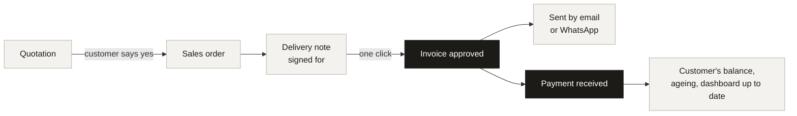
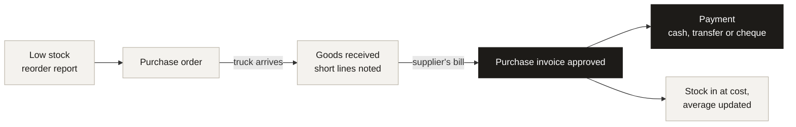
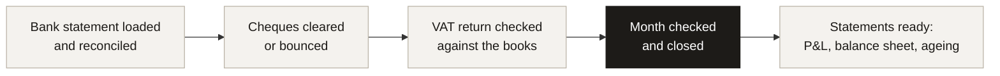

# The three flow pictures

Use these on a slide, in a proposal, or on paper while you talk. Each says what moves when,
which is the question clients ask most. GitHub and VS Code draw them from the Mermaid text below;
the same text is in `diagrams/*.mmd`. PNG versions for slides are not made yet: rendering them
needs the free mermaid-cli tool, which is not installed here.

## 1. Order to cash

**Say:** "Nothing in the books moves until the invoice is approved. Then everything moves at
once: stock, the customer's balance, the accounts and the VAT."

## 2. Purchase to pay

**Say:** "You can't be billed for more than arrived, and the stock comes in at what it really
cost."

## 3. Month end

**Say:** "Before a month is closed Zarvia checks it for you, and once it is closed nobody can
post into it by mistake."

Dark boxes are the steps that post to the books or lock them; light boxes record without posting.
